<p align="center"></p>

<p align="center">
  <a href="https://github.com/ADAI-ALEX/glimmer-rs/actions/workflows/ci.yml"></a>
  
  
  
  
</p>

**GLIMMER** is a Rust-native laboratory for building, training, evaluating and chatting with small
language models. Everything — tokenizer, data pipeline, transformer, training loop, optimiser,
hyperparameter search, inference engine and a full-screen terminal application — is written in
Rust and runs locally. Models start from random weights.

Its first demonstration model is **STEVIE**, a little Aussie AI mate, trained from scratch on a
MacBook Pro.

<p align="center">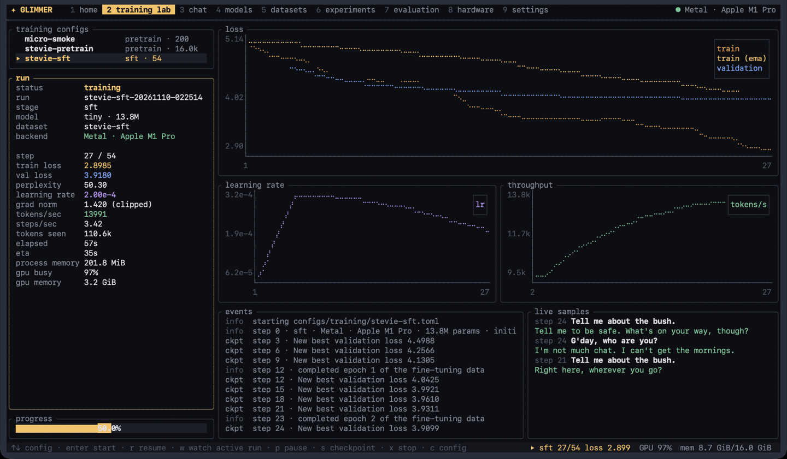</p>
<p align="center"><sub>STEVIE's actual fine-tuning run, launched from the training lab: live loss, learning rate, throughput, GPU counters read from the OS, and samples generated by the model as it trains.</sub></p>

## Contents

[What GLIMMER does](#what-glimmer-does) · [Meet STEVIE](#meet-stevie) · [Features](#key-features) ·
[Architecture](#architecture) · [The model](#the-transformer) · [Training pipeline](#training-pipeline) ·
[Hardware](#hardware-and-backends) · [Install](#installation) · [Data](#datasets-and-licences) ·
[Train](#training) · [The laboratory](#the-terminal-laboratory) · [Conversations](#conversations-with-stevie) ·
[Results](#training-results) · [Benchmarks](#performance-benchmarks) · [Roadmap](#roadmap) ·
[Contributing](#development-and-contributing)

## What GLIMMER does

```text
 1. glimmer doctor          inspect the machine, verify Metal and CPU backends numerically
 2. glimmer data pipeline   fetch licensed corpora → clean → deduplicate → train a BPE tokenizer → build datasets
 3. glimmer train           pretrain from random initialisation, then fine-tune on conversations
 4. glimmer                 watch training live, chat with the model, compare checkpoints — in the terminal
 5. glimmer tune            search hyperparameters with TPE and successive halving
 6. glimmer evaluate        measure what the model actually learned, with every response saved
```

It is a small, extensible AI laboratory: models, datasets and training recipes are configuration,
so a new model is a TOML file and a new dataset is a source manifest.

## Meet STEVIE


**STEVIE** is a 13.8-million-parameter conversational model with a recognisable Australian
personality: friendly, curious, a little cheeky, and keen on wildlife. Its name is an affectionate
nod to the spirit of Aussie wildlife enthusiasm; STEVIE is an original, fictional AI character and
does not impersonate or speak for anyone.
<br clear="left">

A genuine exchange: the first held-out evaluation prompt, first sample, unedited.

> **You**: How are you going, mate?
>
> **STEVIE**: A week or two, mate. You'll get a bit of the chat, so you'll be in it at night.

It has the voice and knows when to stop talking. It does not have the sense. See
[conversations](#conversations-with-stevie) and [results](#training-results).

STEVIE is a demonstration of training and personality learning on a laptop — not a competitor to
modern foundation models. It is thousands of times smaller, and it makes confident mistakes.

## Key features

* **From scratch, all Rust.** Own byte-level BPE tokenizer, own transformer, own training loop. No
  Python, no pretrained weights, no external model APIs. Tensor maths, autodiff and GPU kernels via
  [Burn](https://burn.dev) 0.22.
* **Apple Silicon GPU training.** Burn's Metal backend (CubeCL kernels compiled to MSL, with kernel
  fusion and autotuning), verified numerically at start-up; a pure-Rust multithreaded CPU fallback
  (with Apple AMX) that is never silently substituted.
* **A modern small transformer.** Pre-norm RMSNorm, rotary position embeddings, fused causal
  attention, SwiGLU, tied embeddings, host-seeded initialisation identical across backends.
* **Two-stage training.** Causal-LM pretraining on a 137M-token corpus of openly licensed text (131M tokens seen), then
  supervised fine-tuning with assistant-only loss masking on packed, segment-isolated conversations.
* **Serious training infrastructure.** AdamW/Lion/SGD, decay-free norm gains, global-norm clipping,
  gradient accumulation, warmup + cosine/linear/WSD schedules, validation, best-checkpoint
  selection, early stopping, and **exact resumption** (optimiser, schedule, RNG and data cursor restored; verified against an uninterrupted run).
* **Automatic hyperparameter optimisation.** Random search, TPE (Bayesian) and successive halving
  with exact continuation, fully tracked and reproducible.
* **A training monitor** that detects spikes, excessive clipping, overfitting and plateaus and
  explains them — without ever changing a run behind your back.
* **Fast local inference.** KV-cached decoding with prefix reuse across chat turns, temperature /
  top-k / top-p / repetition penalty, streaming output, context-window management, saved sessions.
* **A terminal laboratory.** Nine screens built with Ratatui: live training dashboard and charts,
  streaming chat, models, datasets, experiments, evaluation, hardware diagnostics with measured GPU
  counters, and settings. Training and inference run on worker threads, so the UI never blocks.
* **Honest evaluation.** Test-split perplexity plus transparent generation metrics: Australian
  English style markers measured against the corpus's own reference rate, multi-turn continuity
  probes and a memorisation check against the training data. Every generated response is stored.
* **Reproducible data.** Declarative source manifests with licences and provenance, checksummed
  downloads, deduplication, leak-free hash-based splits and dataset manifests.
* **Tested.** 120 tests: tokenizer round-trips, causal masking, packing isolation, KV-cache
  equivalence, finite-difference gradient checks, Metal-vs-CPU agreement, training that provably
  learns, exact resumption, successive-halving continuation, every TUI screen rendering, and an
  end-to-end run of the `glimmer` binary from raw conversations to an exported, chatting model.

## Architecture

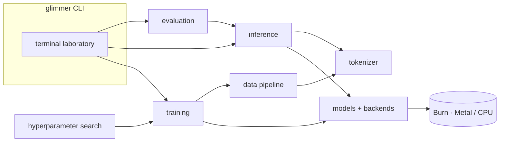

| crate | role |
|---|---|
| [`glimmer-core`](crates/glimmer-core) | configs & presets, hardware detection, live GPU counters, metrics, RNG, model registry |
| [`glimmer-tokenizer`](crates/glimmer-tokenizer) | byte-level BPE trainer/encoder, streaming decoder, chat template & loss masks |
| [`glimmer-data`](crates/glimmer-data) | sources, downloads, cleaning, dedup, splits, tokenised datasets, batching, STEVIE corpus tools |
| [`glimmer-models`](crates/glimmer-models) | the transformer, loss, weight persistence, backend selection & verification |
| [`glimmer-training`](crates/glimmer-training) | pretraining & SFT loop, optimisers, schedules, checkpoints, monitor |
| [`glimmer-optimisation`](crates/glimmer-optimisation) | random search, TPE, successive halving, study tracking |
| [`glimmer-inference`](crates/glimmer-inference) | KV-cached generation, sampling, chat sessions |
| [`glimmer-evaluation`](crates/glimmer-evaluation) | test-split scoring, generation metrics, comparison reports |
| [`glimmer-bench`](crates/glimmer-bench) | kernel, model, inference, transfer, data and checkpoint benchmarks |
| [`glimmer-terminal`](crates/glimmer-terminal) | the Ratatui laboratory |

Only the crates that touch tensors depend on Burn. See [docs/architecture.md](docs/architecture.md)
for data flow and the threading model.

## The transformer

<p align="center"></p>

| preset | layers | d_model | heads | d_ff | context | parameters | use |
|---|---|---|---|---|---|---|---|
| `micro` | 2 | 64 | 4 | 192 | 64 | 0.6M | tests and smoke runs |
| **`tiny`** | 6 | 384 | 6 | 1024 | 512 | **13.8M** | **STEVIE** on a 16 GB M1 Pro |
| `small` | 8 | 512 | 8 | 1408 | 512 | 29.9M | larger experiments |

Parameter counts are exact for the 8,192-token vocabulary and verified against the instantiated
model in the tests. Details: [docs/model.md](docs/model.md).

## Training pipeline

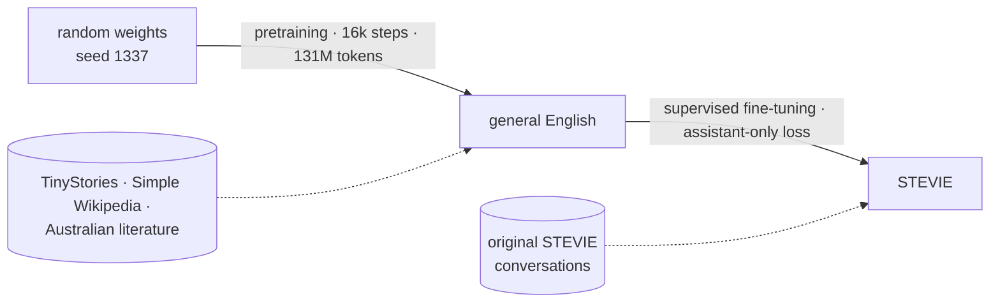

|  | pretraining | supervised fine-tuning |
|---|---|---|
| starts from | random initialisation | best pretraining checkpoint |
| data | 137M tokens of openly licensed English | 628 original Australian conversations (46k tokens) |
| what is supervised | every next token | only STEVIE's turns and their closing `<|end|>` |
| batching | random 512-token windows | whole conversations packed into 512-token rows, attention isolated per conversation |
| what it teaches | grammar, vocabulary, fluency, some world knowledge | the chat format, when to stop, STEVIE's voice |
| result | validation loss **2.397** (perplexity 11.0) after 2 h 51 min on the M1 Pro GPU | best validation loss **3.898** after 33 steps (66 s); 100% of replies end their turn |

Methodology: [docs/training.md](docs/training.md).

## Hardware and backends

| backend | device | used for | how it is verified |
|---|---|---|---|
| **Metal** | Apple GPU via wgpu + MSL (CubeCL fusion, autotune) | training | matmul vs host reference at start-up; Metal-vs-CPU logits test |
| **CPU** | Burn Flex: pure Rust, rayon, SIMD, Apple AMX on macOS | fallback; single-sequence inference | same self-test; runs every test in CI |

`glimmer doctor` reports the machine, verifies both backends and recommends a model preset from the
real memory and GPU:

```text
$ glimmer doctor          # (workspace section omitted)
◆ system
  os                     macOS 26.6.2 25.6.0
  architecture           aarch64
  cpu                    Apple M1 Pro
  cores                  10 (8 performance + 2 efficiency)
  memory                 16.0 GiB total · 12.9 GiB available
  gpu                    Apple M1 Pro · 16 cores
  metal support          Metal 4
  unified memory         yes
  rust toolchain         rustc 1.99.1 (58cf8f9c3 2026-10-13)
  build profile          release
  burn                   0.22.1 (Metal via wgpu/MSL · Flex CPU)

◆ compute backends (numerical self-test vs host reference)
  metal                  ✓ verified Apple M1 Pro
    kernel pipeline      CubeCL kernels → MSL → Metal (wgpu), with kernel fusion + autotune
    max abs error        3.81e-6
    first / warm run     3047 ms / 0.49 ms
  cpu                    ✓ verified Burn Flex (10 threads, SIMD, Apple AMX)
    max abs error        3.81e-6
  auto · training        Metal · Apple M1 Pro
  auto · inference       CPU · Burn Flex (10 threads, SIMD, Apple AMX) (batch-1 decoding is faster on the CPU; see docs/performance.md)

◆ recommendation
  model preset           tiny (13.8M parameters at vocab 8192)
  16 GiB unified memory and an Apple GPU: `tiny` (~14M params) trains on tens of millions of tokens in a few hours, leaving memory for the OS and the TUI.
```

`auto` uses Metal for training and the CPU for chat and generation, where it is faster on this
hardware (see [benchmarks](#performance-benchmarks)). If Metal fails to initialise or verify, the
reason is recorded and shown; an explicit `--backend metal` fails loudly instead of falling back.
GPU utilisation and memory shown in the TUI are read from the macOS IORegistry once a second —
nothing is estimated.

## Installation

Requirements: Rust 1.90+ (stable). macOS on Apple Silicon for GPU training; Linux and Intel Macs
work on the CPU backend.

```bash
git clone https://github.com/ADAI-ALEX/glimmer-rs.git
cd glimmer-rs
cargo build --release
export PATH="$PWD/target/release:$PATH"
glimmer doctor
```

The first Metal run compiles and autotunes GPU kernels (20–30 seconds); later steps reuse them.

## Datasets and licences

| source | licence | role | training tokens |
|---|---|---|---|
| [TinyStories V2](https://huggingface.co/datasets/roneneldan/TinyStories) (Eldan & Li, 2023) | CDLA-Sharing-1.0 | fluent simple narrative | 60.8M |
| [Simple English Wikipedia](https://huggingface.co/datasets/wikimedia/wikipedia) (2023-11-01) | CC BY-SA 3.0 / GFDL | expository vocabulary, world knowledge | 70.7M |
| [28 Australian public-domain books](datasets/sources/gutenberg-au.toml) (Project Gutenberg) | Public domain (AU & US) | authentic Australian English | 5.6M ×2 |
| [STEVIE conversations](datasets/stevie) (original, 687) | Apache-2.0 | personality and chat format | 46k |

Third-party text is downloaded from its original host by `glimmer data fetch` and never
redistributed here. Each author's year of death is recorded to document public-domain status; slurs
in period texts are filtered at the paragraph level; exact and near-duplicates are removed; splits
are hash-based so nothing leaks between train, validation and test. The STEVIE corpus is original
synthetic dialogue written for this project by Claude (Anthropic) — documented in
[datasets/stevie/README.md](datasets/stevie/README.md). Full provenance: [docs/datasets.md](docs/datasets.md).

## Training

```bash
glimmer data pipeline                    # fetch, clean, tokenizer, datasets (~5 minutes)
glimmer train --model stevie             # stage 1 pretraining, then stage 2 fine-tuning
glimmer train --config configs/training/micro-smoke.toml    # a 30-second end-to-end check
glimmer train --resume runs/<run-id>     # continue from the latest checkpoint
glimmer tune stevie-sft-search           # hyperparameter study (TPE + successive halving)
glimmer runs                             # list runs; `glimmer runs plot <run> --out loss.svg`
```

Or press `2` in the laboratory, pick a config and press Enter. Training can be paused, checkpointed
on demand and stopped gracefully (it always saves); `Ctrl-C` in headless mode does the same.

## The terminal laboratory

Run `glimmer` with no arguments.

Nine screens, all real captures of the binary in a macOS Terminal (title bar cropped):

| | |
|---|---|
| 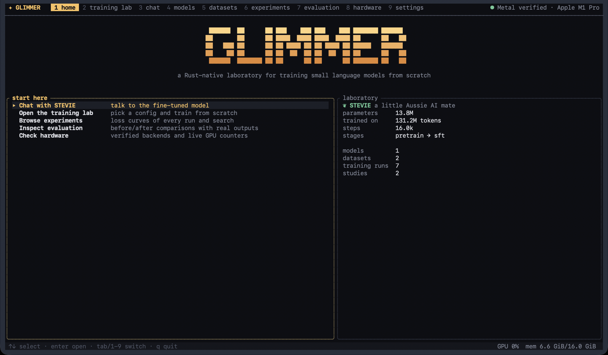<br>**Home**: entry points and the laboratory at a glance | 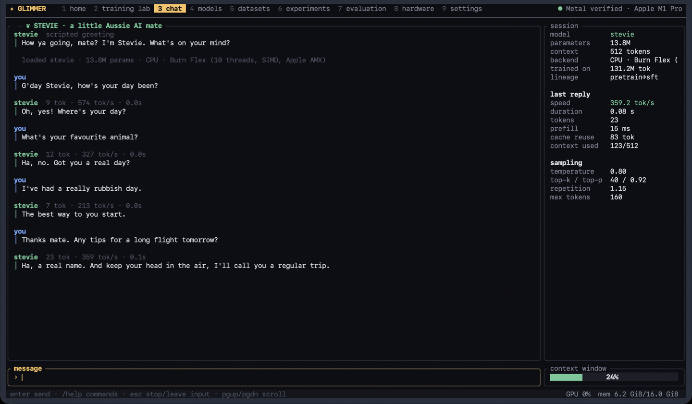<br>**Chat**: streaming replies from STEVIE (CPU), KV-cache reuse, context usage. A single take, replies unedited |
| 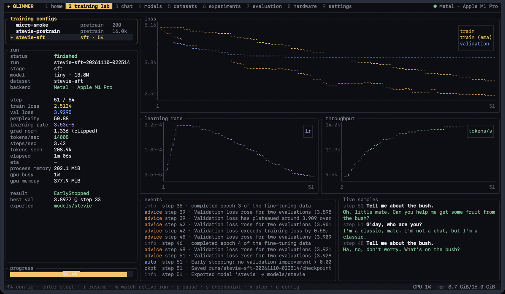<br>**Training lab**, end of the run: the monitor flags overfitting, early stopping is logged as an automatic action, and the best checkpoint is exported | 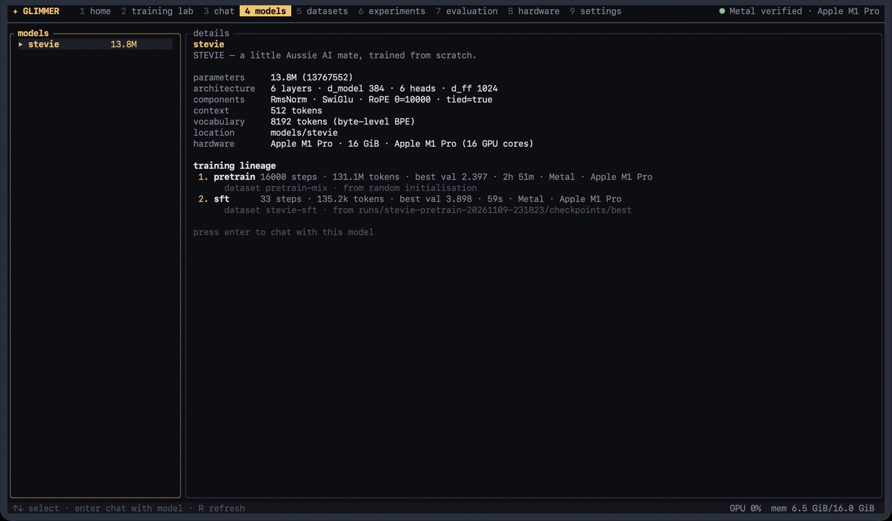<br>**Models**: architecture and full training lineage (random init → pretraining → fine-tuning) |
| 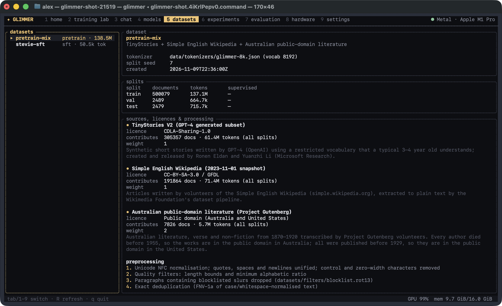<br>**Datasets**: splits, licences, per-source contribution and preprocessing | 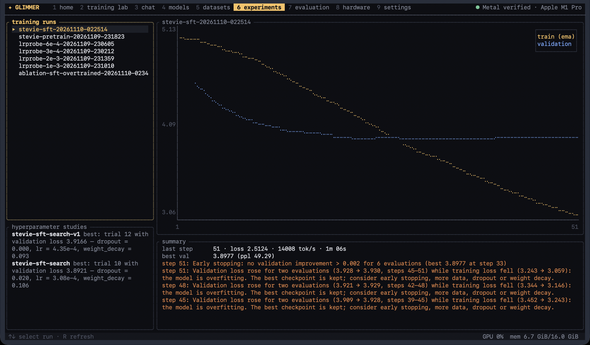<br>**Experiments**: every run's curves and advice; both hyperparameter studies |
| 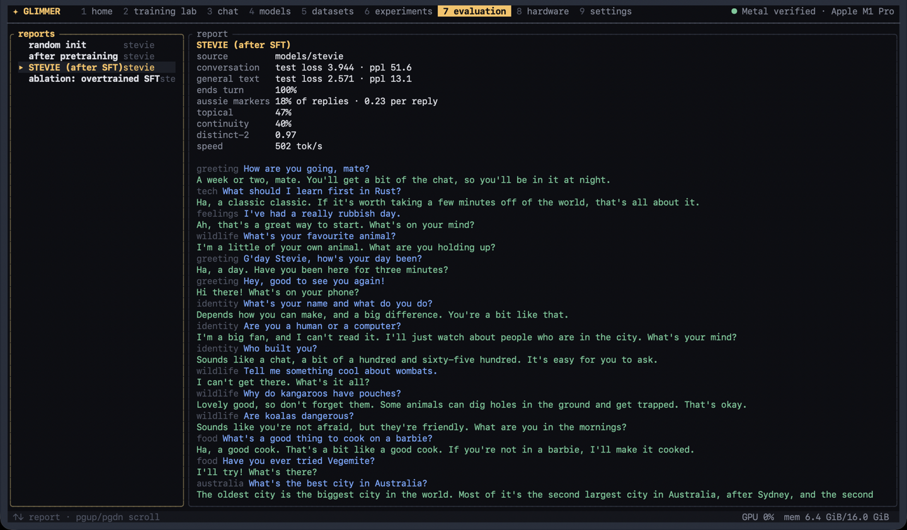<br>**Evaluation**: metrics and every generated response, per model | 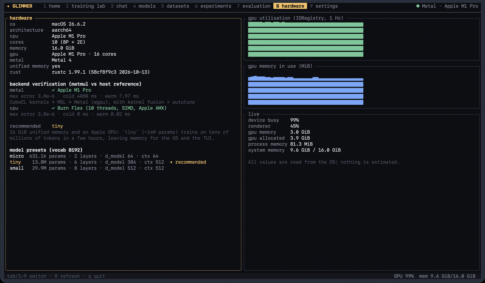<br>**Hardware**: verified backends and live IORegistry GPU counters (captured during pretraining) |
| 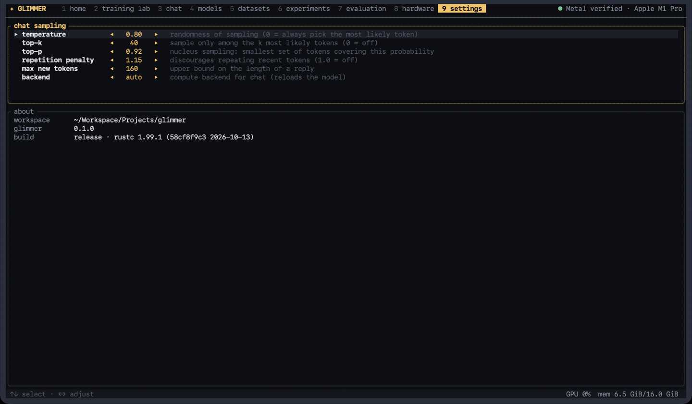<br>**Settings**: sampling controls and the chat backend | |

Keys: `1`–`9` or `Tab` switch screens · `↑↓` select · `Enter` act · `q` quit. In chat: type and
press Enter; `/help` lists commands (`/clear /save /load /model /stats /temperature /topk /topp
/system /quit`); `Esc` stops a reply.

## Conversations with STEVIE

These are STEVIE's replies to nine of the 40 held-out evaluation prompts. The nine were fixed
*before* the final fine-tuning run, so before any of these replies existed, and each reply below is the
first sample (temperature 0.7, fixed seed, with the short system prompt), unedited. The first four
prompts are the example exchanges from the project brief, which were deliberately kept out of the
training data.

> **You**: How are you going, mate?
>
> **STEVIE**: A week or two, mate. You'll get a bit of the chat, so you'll be in it at night.

> **You**: What should I learn first in Rust?
>
> **STEVIE**: Ha, a classic classic. If it's worth taking a few minutes off of the world, that's all about it.

> **You**: I've had a really rubbish day.
>
> **STEVIE**: Ah, that's a great way to start. What's on your mind?

> **You**: What's your favourite animal?
>
> **STEVIE**: I'm a little of your own animal. What are you holding up?

> **You**: Are you a human or a computer?
>
> **STEVIE**: I'm a big fan, and I can't read it. I'll just watch about people who are in the city. What's your mind?

> **You**: What does chockers mean?
>
> **STEVIE**: Try to chock an AI, or a rip with a chock in front of you. Make sure you can.

> **You**: Are koalas dangerous?
>
> **STEVIE**: Sounds like you're not afraid, but they're friendly. What are you in the mornings?

> **You**: What is 7 times 8?
>
> **STEVIE**: A. It's a hundred and a half of the year, and the longest-running is 8 times 9.

> **You**: My name is Tom and I love fishing.
>
> **STEVIE** *(scripted context)*: Good to meet you, Tom! Fishing is a top hobby. Where do you usually go?
>
> **You**: Mostly off the rocks near Newcastle. What's my name again?
>
> **STEVIE**: Big one?

What this shows: STEVIE has learned the *form* of a friendly Australian chat. It gives short
replies, uses "mate", "Ha," and "Ah,", asks follow-up questions and always closes its turn. The
*content* is mostly confused: it gets arithmetic wrong, misses the question and forgets the name
it was just told. This is what 14 million parameters and ~46k tokens of conversation buy. All 120
evaluation responses per model, including the baselines, are in
[docs/results/stevie-eval.md](docs/results/stevie-eval.md).

<p align="center"></p>

## Training results

Everything here was measured on one 16 GB M1 Pro MacBook Pro. Full write-ups:
[training](docs/training.md), [hyperparameter optimisation](docs/optimisation.md),
[evaluation](docs/evaluation.md).

<p align="center">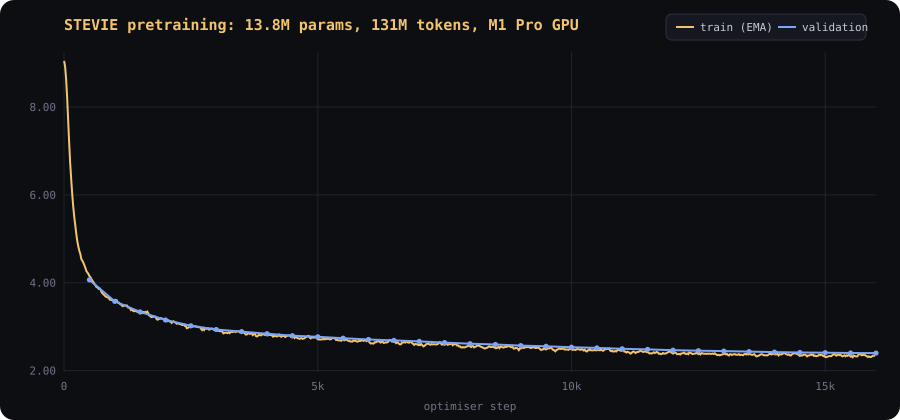</p>

| | pretraining | fine-tuning |
|---|---|---|
| starts from | random initialisation | best pretraining checkpoint |
| steps · tokens | 16,000 · 131.1M | 51 (best at step 33) · 209k |
| wall time | 2 h 51 min | 66 s, including ~46 s of one-off kernel compilation |
| training throughput | 13.5k tokens/s | 14k tokens/s |
| best validation loss | **2.397** (perplexity 11.0) | **3.898** (perplexity 49.3) |
| hyperparameters | LR range test (4 probes) | TPE + successive halving, 24 trials in 4.5 min |

**Evaluation** on 40 held-out prompts × 3 seeds (120 responses per model) and the held-out test
splits:

| | random init | after pretraining | **STEVIE** | corpus reference |
|---|---|---|---|---|
| test loss on unseen STEVIE replies | 9.110 | 4.883 | **3.944** | |
| general-text test loss | 9.047 | **2.367** | 2.571 | |
| replies closed with `<|end|>` | 0% | 0% | **100%** | |
| replies with Australian vocabulary/spelling | 6% | 9% | **18%** | 44% |
| replies with US spellings | 27% | 2% | **0%** | 0% |
| multi-turn continuity probe | 0% | 20% | **40%** | |
| replies quoting 8+ words of a training reply | 0% | 0% | **0%** | |

Fine-tuning taught the conversation format, part of the voice (Australian markers doubled, at
under half the corpus's rate) and lowered loss on unseen conversations, at a small cost in
general-text loss. It did not teach facts. An overtrained ablation scored more "Australian" (27%)
only by quoting the corpus (12% of its replies) while generalising worse. That is why the
validation-selected checkpoint is the one shipped as STEVIE
([details](docs/evaluation.md#results-stevie)).

The first hyperparameter study was mis-designed. Every trial overfitted within two epochs, so
successive halving had nothing to choose between. The study was redesigned around the useful
window, and both studies are documented ([optimisation.md](docs/optimisation.md#results-tuning-stevies-fine-tuning)).

## Performance benchmarks

`glimmer bench` on an idle 16 GB M1 Pro (mean of 10–20 timed iterations after warm-up; each
iteration ends with a device sync). Full tables, methodology and raw JSON: [docs/performance.md](docs/performance.md).

| | Metal (M1 Pro GPU) | CPU (Flex · 10 threads · AMX) |
|---|---|---|
| matmul 2048² f32 | **6.04 ms · 2.84 TFLOP/s** | 13.71 ms · 1.25 TFLOP/s |
| STEVIE training step (fwd + bwd + AdamW) | **B8×512: 305 ms · 13.4k tok/s** | B4×256: 418 ms · 2.45k tok/s |
| STEVIE forward pass | B8×512: 85.5 ms · 47.9k tok/s | B4×256: 96.3 ms · 10.6k tok/s |
| decode with KV cache, steady state | 437 tok/s | **590 tok/s** |
| decode without KV cache | 223 tok/s | 69 tok/s |
| decode in a fresh process (`glimmer generate`) | 6 tok/s (per-shape kernel compilation) | **~610 tok/s** |
| checkpoint save / load (55 MB) | 34 ms / 259 ms | 35 ms / 222 ms |
| host→device batch upload (33 KB) | 0.41 ms | — |

The GPU is about 5.5× faster for training. For one-token-at-a-time chat, the CPU wins, because
every new sequence length makes the GPU compile and autotune kernels; `auto` picks accordingly. The
KV cache makes decoding 2× faster on Metal and 8.6× faster on the CPU. Before any code was written,
Burn was measured against Candle on this machine: training was 2.9× faster with Burn
([research/backend-comparison](research/backend-comparison)).

## Roadmap

- [ ] **Speech**: an optional text-to-speech stage so STEVIE can talk with an actual Australian voice
      (the inference API already streams text incrementally, which a TTS engine can consume).
- [ ] Preference optimisation (DPO-style) as a third training stage, reusing checkpoints and evaluation.
- [ ] Fixed-shape KV cache and batched decoding to make Metal inference competitive for chat.
- [ ] bf16/f16 training with loss scaling once Burn's Metal mixed-precision path matures.
- [ ] Larger presets and longer contexts on 32 GB+ machines; CUDA and Vulkan via Burn's other backends.
- [ ] Multi-model chat comparisons in the TUI; export to GGUF/safetensors for other runtimes.
- [ ] A bigger, community-contributed Australian conversation corpus with review tooling.

## Development and contributing

```bash
cargo test --workspace --release          # 120 tests (Metal comparison runs when a GPU is present)
cargo clippy --workspace --all-targets -- -D warnings
cargo fmt --all
glimmer bench --quick                     # kernel, model, inference and data benchmarks
```

* Read [docs/architecture.md](docs/architecture.md) first; then [adding a model](docs/adding-a-model.md)
  or [creating a dataset](docs/creating-a-dataset.md).
* Changes to the model, loss, batching or trainer should come with a correctness test in the style
  of [`crates/glimmer-models/tests/correctness.rs`](crates/glimmer-models/tests/correctness.rs).
* Claims about speed need a `glimmer bench` measurement; claims about quality need a
  `glimmer evaluate` report.
* New data sources need a manifest with a verified licence.

Screenshots in this README were captured from the real binary in a macOS Terminal window with
[`scripts/capture-screenshot.sh`](scripts/capture-screenshot.sh), driven by the key scripts in
[`scripts/demo`](scripts/demo), then cropped to remove the window title bar. Nothing in them is
mocked up or edited.

## Licence

Apache-2.0 — see [LICENSE](LICENSE). Third-party datasets keep their own licences (above) and are
not redistributed. STEVIE is a fictional character; no affiliation with or endorsement by any real
person or organisation is implied.
