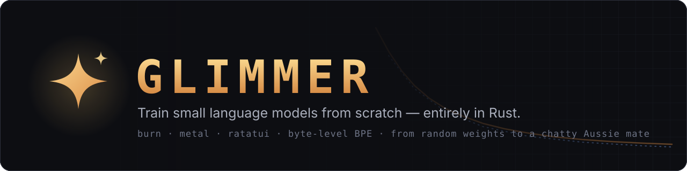
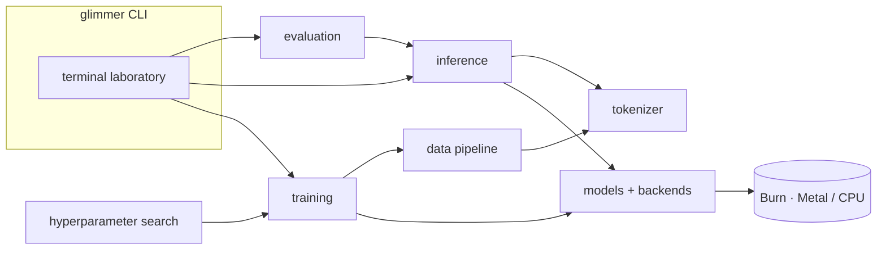
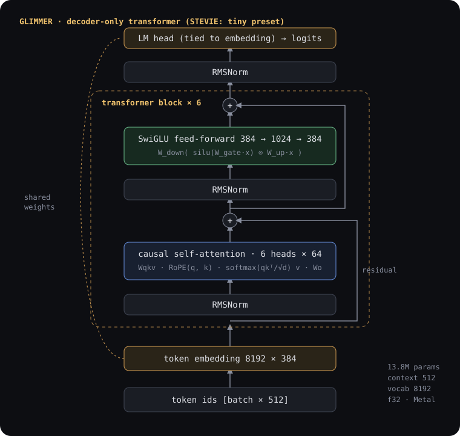
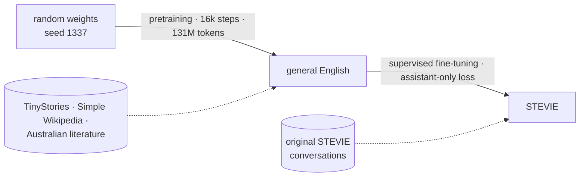

<p align="center"></p>

<p align="center">
  <a href="https://github.com/ADAI-ALEX/glimmer-rs/actions/workflows/ci.yml"></a>
  
  
  
  
</p>

**GLIMMER** is a Rust-native laboratory for building, training, evaluating and chatting with small
language models. Everything — tokenizer, data pipeline, transformer, training loop, optimiser,
hyperparameter search, inference engine and a full-screen terminal application — is written in
Rust and runs locally. Models start from random weights.

Its first demonstration model is **STEVIE**, a little Aussie AI mate, trained from scratch on a
MacBook Pro.

<!-- HERO_SCREENSHOT -->

## Contents

[What GLIMMER does](#what-glimmer-does) · [Meet STEVIE](#meet-stevie) · [Features](#key-features) ·
[Architecture](#architecture) · [The model](#the-transformer) · [Training pipeline](#training-pipeline) ·
[Hardware](#hardware-and-backends) · [Install](#installation) · [Data](#datasets-and-licences) ·
[Train](#training) · [The laboratory](#the-terminal-laboratory) · [Conversations](#conversations-with-stevie) ·
[Results](#training-results) · [Benchmarks](#performance-benchmarks) · [Roadmap](#roadmap) ·
[Contributing](#development-and-contributing)

## What GLIMMER does

```text
 1. glimmer doctor          inspect the machine, verify Metal and CPU backends numerically
 2. glimmer data pipeline   fetch licensed corpora → clean → deduplicate → train a BPE tokenizer → build datasets
 3. glimmer train           pretrain from random initialisation, then fine-tune on conversations
 4. glimmer                 watch training live, chat with the model, compare checkpoints — in the terminal
 5. glimmer tune            search hyperparameters with TPE and successive halving
 6. glimmer evaluate        measure what the model actually learned, with every response saved
```

It is a small, extensible AI laboratory: models, datasets and training recipes are configuration,
so a new model is a TOML file and a new dataset is a source manifest.

## Meet STEVIE


**STEVIE** is a 13.8-million-parameter conversational model with a recognisable Australian
personality: friendly, curious, a little cheeky, and keen on wildlife. Its name is an affectionate
nod to the spirit of Aussie wildlife enthusiasm; STEVIE is an original, fictional AI character and
does not impersonate or speak for anyone.
<br clear="left">

<!-- STEVIE_INTRO_EXAMPLE -->

STEVIE is a demonstration of training and personality learning on a laptop — not a competitor to
modern foundation models. It is thousands of times smaller, and it makes confident mistakes.

## Key features

* **From scratch, all Rust.** Own byte-level BPE tokenizer, own transformer, own training loop. No
  Python, no pretrained weights, no external model APIs. Tensor maths, autodiff and GPU kernels via
  [Burn](https://burn.dev) 0.22.
* **Apple Silicon GPU training.** Burn's Metal backend (CubeCL kernels compiled to MSL, with kernel
  fusion and autotuning), verified numerically at start-up; a pure-Rust multithreaded CPU fallback
  (with Apple AMX) that is never silently substituted.
* **A modern small transformer.** Pre-norm RMSNorm, rotary position embeddings, fused causal
  attention, SwiGLU, tied embeddings, host-seeded initialisation identical across backends.
* **Two-stage training.** Causal-LM pretraining on 137M tokens of openly licensed text, then
  supervised fine-tuning with assistant-only loss masking on packed, segment-isolated conversations.
* **Serious training infrastructure.** AdamW/Lion/SGD, decay-free norm gains, global-norm clipping,
  gradient accumulation, warmup + cosine/linear/WSD schedules, validation, best-checkpoint
  selection, early stopping, and **bit-exact resumption** (optimiser, schedule, RNG, data cursor).
* **Automatic hyperparameter optimisation.** Random search, TPE (Bayesian) and successive halving
  with exact continuation, fully tracked and reproducible.
* **A training monitor** that detects spikes, excessive clipping, overfitting and plateaus and
  explains them — without ever changing a run behind your back.
* **Fast local inference.** KV-cached decoding with prefix reuse across chat turns, temperature /
  top-k / top-p / repetition penalty, streaming output, context-window management, saved sessions.
* **A terminal laboratory.** Nine screens built with Ratatui: live training dashboard and charts,
  streaming chat, models, datasets, experiments, evaluation, hardware diagnostics with measured GPU
  counters, and settings. Training and inference run on worker threads, so the UI never blocks.
* **Honest evaluation.** Test-split perplexity plus transparent generation metrics, Australian
  English style markers and multi-turn continuity probes, with every generated response stored.
* **Reproducible data.** Declarative source manifests with licences and provenance, checksummed
  downloads, deduplication, leak-free hash-based splits and dataset manifests.
* **Tested.** 117 tests: tokenizer round-trips, causal masking, packing isolation, KV-cache
  equivalence, finite-difference gradient checks, Metal-vs-CPU agreement, training that provably
  learns, exact resumption, successive-halving continuation, and every TUI screen rendering.

## Architecture



| crate | role |
|---|---|
| [`glimmer-core`](crates/glimmer-core) | configs & presets, hardware detection, live GPU counters, metrics, RNG, model registry |
| [`glimmer-tokenizer`](crates/glimmer-tokenizer) | byte-level BPE trainer/encoder, streaming decoder, chat template & loss masks |
| [`glimmer-data`](crates/glimmer-data) | sources, downloads, cleaning, dedup, splits, tokenised datasets, batching, STEVIE corpus tools |
| [`glimmer-models`](crates/glimmer-models) | the transformer, loss, weight persistence, backend selection & verification |
| [`glimmer-training`](crates/glimmer-training) | pretraining & SFT loop, optimisers, schedules, checkpoints, monitor |
| [`glimmer-optimisation`](crates/glimmer-optimisation) | random search, TPE, successive halving, study tracking |
| [`glimmer-inference`](crates/glimmer-inference) | KV-cached generation, sampling, chat sessions |
| [`glimmer-evaluation`](crates/glimmer-evaluation) | test-split scoring, generation metrics, comparison reports |
| [`glimmer-bench`](crates/glimmer-bench) | kernel, model, inference, transfer, data and checkpoint benchmarks |
| [`glimmer-terminal`](crates/glimmer-terminal) | the Ratatui laboratory |

Only the crates that touch tensors depend on Burn. See [docs/architecture.md](docs/architecture.md)
for data flow and the threading model.

## The transformer

<p align="center"></p>

| preset | layers | d_model | heads | d_ff | context | parameters | use |
|---|---|---|---|---|---|---|---|
| `micro` | 2 | 64 | 4 | 192 | 64 | 0.6M | tests and smoke runs |
| **`tiny`** | 6 | 384 | 6 | 1024 | 512 | **13.8M** | **STEVIE** on a 16 GB M1 Pro |
| `small` | 8 | 512 | 8 | 1408 | 512 | 29.9M | larger experiments |

Parameter counts are exact for the 8,192-token vocabulary and verified against the instantiated
model in the tests. Details: [docs/model.md](docs/model.md).

## Training pipeline



|  | pretraining | supervised fine-tuning |
|---|---|---|
| starts from | random initialisation | best pretraining checkpoint |
| data | 137M tokens of openly licensed English | 628 original Australian conversations (46k tokens) |
| what is supervised | every next token | only STEVIE's turns and their closing `<|end|>` |
| batching | random 512-token windows | whole conversations packed into 512-token rows, attention isolated per conversation |
| what it teaches | grammar, vocabulary, fluency, some world knowledge | the chat format, when to stop, STEVIE's voice |
| <!-- PIPELINE_ROW --> | | |

Methodology: [docs/training.md](docs/training.md).

## Hardware and backends

| backend | device | used for | how it is verified |
|---|---|---|---|
| **Metal** | Apple GPU via wgpu + MSL (CubeCL fusion, autotune) | training | matmul vs host reference at start-up; Metal-vs-CPU logits test |
| **CPU** | Burn Flex: pure Rust, rayon, SIMD, Apple AMX on macOS | fallback; single-sequence inference | same self-test; runs every test in CI |

`glimmer doctor` reports the machine, verifies both backends and recommends a model preset from the
real memory and GPU:

<!-- DOCTOR_OUTPUT -->

`auto` uses Metal for training and the CPU for chat and generation, where it is faster on this
hardware (see [benchmarks](#performance-benchmarks)). If Metal fails to initialise or verify, the
reason is recorded and shown; an explicit `--backend metal` fails loudly instead of falling back.
GPU utilisation and memory shown in the TUI are read from the macOS IORegistry once a second —
nothing is estimated.

## Installation

Requirements: Rust 1.90+ (stable). macOS on Apple Silicon for GPU training; Linux and Intel Macs
work on the CPU backend.

```bash
git clone https://github.com/ADAI-ALEX/glimmer-rs.git
cd glimmer-rs
cargo build --release
export PATH="$PWD/target/release:$PATH"
glimmer doctor
```

The first Metal run compiles and autotunes GPU kernels (around 20 seconds); later steps reuse them.

## Datasets and licences

| source | licence | role | training tokens |
|---|---|---|---|
| [TinyStories V2](https://huggingface.co/datasets/roneneldan/TinyStories) (Eldan & Li, 2023) | CDLA-Sharing-1.0 | fluent simple narrative | 60.8M |
| [Simple English Wikipedia](https://huggingface.co/datasets/wikimedia/wikipedia) (2023-11-01) | CC BY-SA 3.0 / GFDL | expository vocabulary, world knowledge | 70.7M |
| [28 Australian public-domain books](datasets/sources/gutenberg-au.toml) (Project Gutenberg) | Public domain (AU & US) | authentic Australian English | 5.6M ×2 |
| [STEVIE conversations](datasets/stevie) (original, 687) | Apache-2.0 | personality and chat format | 46k |

Third-party text is downloaded from its original host by `glimmer data fetch` and never
redistributed here. Each author's year of death is recorded to document public-domain status; slurs
in period texts are filtered at the paragraph level; exact and near-duplicates are removed; splits
are hash-based so nothing leaks between train, validation and test. The STEVIE corpus is original
synthetic dialogue written for this project by Claude (Anthropic) — documented in
[datasets/stevie/README.md](datasets/stevie/README.md). Full provenance: [docs/datasets.md](docs/datasets.md).

## Training

```bash
glimmer data pipeline                    # fetch, clean, tokenizer, datasets (~5 minutes)
glimmer train --model stevie             # stage 1 pretraining, then stage 2 fine-tuning
glimmer train --config configs/training/micro-smoke.toml    # a 30-second end-to-end check
glimmer train --resume runs/<run-id>     # continue from the latest checkpoint
glimmer tune stevie-sft-search           # hyperparameter study (TPE + successive halving)
glimmer runs                             # list runs; `glimmer runs plot <run> --out loss.svg`
```

Or press `2` in the laboratory, pick a config and press Enter. Training can be paused, checkpointed
on demand and stopped gracefully (it always saves); `Ctrl-C` in headless mode does the same.

## The terminal laboratory

Run `glimmer` with no arguments.

<!-- SCREENSHOTS -->

Keys: `1`–`9` or `Tab` switch screens · `↑↓` select · `Enter` act · `q` quit. In chat: type and
press Enter; `/help` lists commands (`/clear /save /load /model /stats /temperature /topk /topp
/system /quit`); `Esc` stops a reply.

## Conversations with STEVIE

<!-- CONVERSATIONS -->

## Training results

<!-- RESULTS -->

## Performance benchmarks

<!-- BENCHMARKS -->

## Roadmap

- [ ] **Speech**: an optional text-to-speech stage so STEVIE can talk with an actual Australian voice
      (the inference API already streams text incrementally, which a TTS engine can consume).
- [ ] Preference optimisation (DPO-style) as a third training stage, reusing checkpoints and evaluation.
- [ ] Fixed-shape KV cache and batched decoding to make Metal inference competitive for chat.
- [ ] bf16/f16 training with loss scaling once Burn's Metal mixed-precision path matures.
- [ ] Larger presets and longer contexts on 32 GB+ machines; CUDA and Vulkan via Burn's other backends.
- [ ] Multi-model chat comparisons in the TUI; export to GGUF/safetensors for other runtimes.
- [ ] A bigger, community-contributed Australian conversation corpus with review tooling.

## Development and contributing

```bash
cargo test --workspace --release          # 117 tests (Metal comparison runs when a GPU is present)
cargo clippy --workspace --all-targets -- -D warnings
cargo fmt --all
glimmer bench --quick                     # kernel, model, inference and data benchmarks
```

* Read [docs/architecture.md](docs/architecture.md) first; then [adding a model](docs/adding-a-model.md)
  or [creating a dataset](docs/creating-a-dataset.md).
* Changes to the model, loss, batching or trainer should come with a correctness test in the style
  of [`crates/glimmer-models/tests/correctness.rs`](crates/glimmer-models/tests/correctness.rs).
* Claims about speed need a `glimmer bench` measurement; claims about quality need a
  `glimmer evaluate` report.
* New data sources need a manifest with a verified licence.

Screenshots in this README were captured from the real binary in a macOS Terminal window with
[`scripts/capture-screenshot.sh`](scripts/capture-screenshot.sh).

## Licence

Apache-2.0 — see [LICENSE](LICENSE). Third-party datasets keep their own licences (above) and are
not redistributed. STEVIE is a fictional character; no affiliation with or endorsement by any real
person or organisation is implied.
