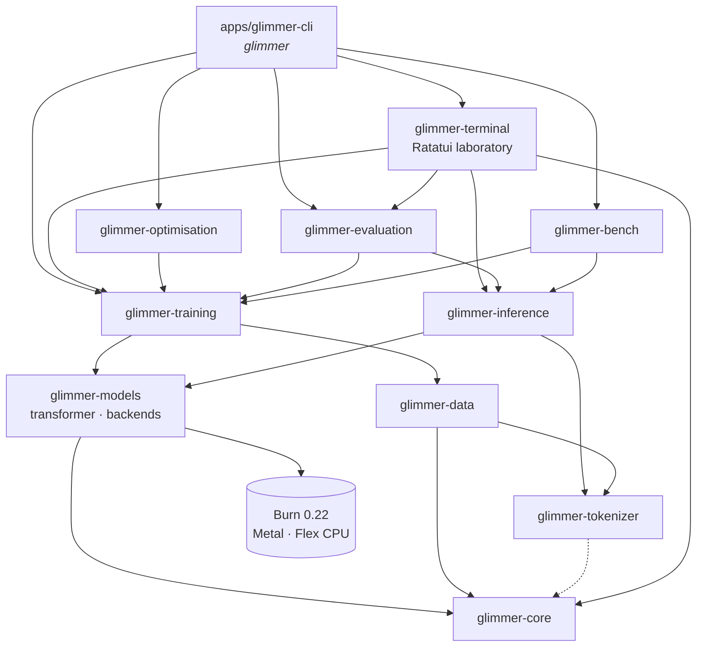
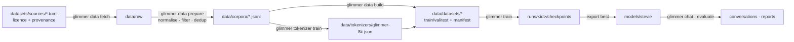
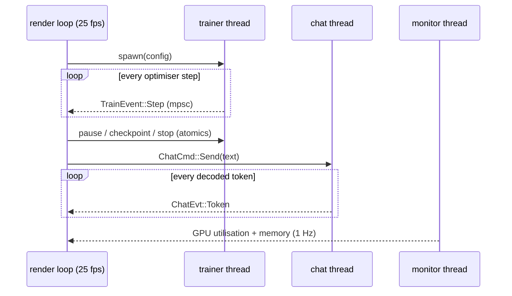

# System architecture

GLIMMER is a Cargo workspace of focused crates. Each crate has one responsibility and a small
public surface, so models, datasets, the trainer, the inference engine and the terminal UI can
evolve independently.



| crate | responsibility | depends on Burn? |
|---|---|---|
| `glimmer-core` | configuration, presets, hardware inspection, live GPU counters, metric records, RNG, model registry, workspace paths | no |
| `glimmer-tokenizer` | byte-level BPE (training, encoding, streaming decoding), chat template and loss masks | no |
| `glimmer-data` | source manifests, downloads, cleaning, deduplication, splits, tokenised datasets, batching, STEVIE corpus | no |
| `glimmer-models` | the transformer, loss, weight persistence, backend selection and verification | **yes** |
| `glimmer-training` | pretraining/SFT loop, optimisers, clipping, schedules, checkpoints, monitor | yes |
| `glimmer-optimisation` | random search, TPE, successive halving, study tracking | yes (via training) |
| `glimmer-inference` | KV-cached generation, sampling, chat sessions | yes |
| `glimmer-evaluation` | test-split scoring, generation metrics, before/after reports | yes |
| `glimmer-bench` | kernel, model, inference, data and checkpoint benchmarks | yes |
| `glimmer-terminal` | the interactive laboratory | yes (through workers) |
| `apps/glimmer-cli` | the `glimmer` binary | — |

The Burn boundary is deliberate: everything that only needs configuration, metrics or text
(tokenizer, data pipeline, config validation, registry) builds and tests without a tensor
runtime.

## Data flow



Every stage writes a machine-readable record: download provenance with SHA-256, corpus
statistics, dataset manifests (sources, licences, token counts, preprocessing steps), training
metrics (`metrics.jsonl`), checkpoint metadata, model cards with full training lineage, and
evaluation reports containing every generated response.

## Threading model

Training and inference are compute-bound, so GLIMMER uses plain OS threads and channels rather
than an async runtime (Tokio was evaluated and rejected: nothing in the hot path waits on I/O).



* The **trainer** reports through a callback; the TUI forwards events over `mpsc`, the CLI prints
  them, hyperparameter search records them. Pause, stop and "checkpoint now" are lock-free atomic
  flags checked between steps, so stopping is always graceful and always saves a checkpoint.
* The **chat worker** owns the model and its KV cache; tokens stream back as they decode, and a
  cancellation flag stops generation mid-reply.
* The **monitor** reads Apple GPU counters from the IORegistry and memory from the OS once a
  second. Nothing in the UI is estimated or simulated.

## Backend dispatch

Burn 0.22 dispatches on the `Device` at runtime instead of through a generic backend parameter,
so a single binary contains both backends:

* **Metal** — `Device::metal(DefaultDevice)`: wgpu's Metal backend with CubeCL kernels compiled
  to native MSL, kernel fusion and autotuning. Initialisation fails rather than silently falling
  back to WGSL if MSL is unavailable.
* **CPU** — `Device::flex()`: Burn's pure-Rust backend, multithreaded with rayon, SIMD, and Apple
  AMX matrix units on macOS.

`glimmer_models::backend::select` opens a backend and runs a numerical self-test (a matmul
compared with a host reference). `auto` prefers Metal and records an explicit reason if it falls
back to the CPU; an explicit `metal` request fails loudly instead.

## Directory layout

```text
glimmer/
├── apps/glimmer-cli/          the `glimmer` binary
├── crates/                    the framework (see table above)
├── configs/
│   ├── models/                model recipes (stages to run, e.g. stevie.toml)
│   ├── training/              training configs (pretrain, SFT, smoke tests)
│   ├── datasets/              dataset build specs
│   ├── tokenizers/            tokenizer training specs
│   └── tuning/                hyperparameter study specs
├── datasets/
│   ├── sources/               one manifest per data source (licence, provenance, cleaning)
│   ├── stevie/                the original STEVIE corpus and held-out evaluation prompts
│   └── filters/               the ROT13-encoded slur blocklist
├── docs/                      this documentation
├── assets/                    branding, diagrams, genuine screenshots
├── scripts/                   screenshot capture tooling
├── data/        (ignored)     downloads, corpora, tokenizers, tokenised datasets
├── runs/        (ignored)     training runs, checkpoints, benchmarks, evaluation reports
├── experiments/ (ignored)     hyperparameter studies
└── models/      (ignored)     exported, ready-to-chat models
```
