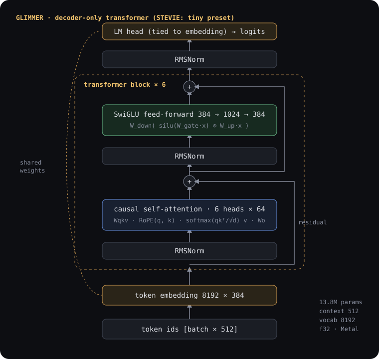

# Model internals

GLIMMER's model is a decoder-only transformer in the modern "Llama-style" family, sized for
training from scratch on a laptop. Implementation: [`crates/glimmer-models/src/transformer.rs`](../crates/glimmer-models/src/transformer.rs).

<p align="center"></p>

## Components and why they were chosen

| component | choice | rationale |
|---|---|---|
| normalisation | **pre-norm RMSNorm** (LayerNorm optional) | Pre-norm keeps gradients well-scaled through the residual stream, so small models train stably with a short warmup. RMSNorm drops the mean-centring of LayerNorm at no loss in quality. |
| positions | **rotary embeddings (RoPE)**, rotate-half form, θ = 10,000 | Relative position information with no learned parameters; supports a position *offset* (KV-cached decoding) and *explicit per-token positions* (packed SFT rows restart at 0 for each conversation). |
| attention | **causal multi-head self-attention** via Burn's fused `attention` op | Bottom-right-aligned causal masking is exactly right when keys include a cached prefix. Under autodiff, Burn uses its decomposed reference implementation, which has a complete backward pass. |
| feed-forward | **SwiGLU** (GELU optional) | Gated units consistently beat plain MLPs at equal parameter count. `d_ff` is set to ≈ 8/3·d_model so the three projections cost about as much as a 4× GELU MLP. |
| output | **tied embeddings** | The LM head reuses the token-embedding matrix. At vocab 8192 × d_model 384, untying would add 3.1M parameters — 23% of the model — for little benefit at this scale. |
| biases | none | Linear layers carry no bias terms (standard in modern LMs; fewer parameters, no effect on quality). |
| dropout | configurable (embedding + residual branches) | 0 for pretraining (one pass over a large corpus does not overfit); tuned for SFT on the small conversation corpus. |

## Presets

Parameter counts below are exact for vocabulary 8192 (the `glimmer-8k` tokenizer) and are
checked against the instantiated model in the test suite.

| preset | layers | d_model | heads × dim | d_ff | context | parameters | purpose |
|---|---|---|---|---|---|---|---|
| `micro` | 2 | 64 | 4 × 16 | 192 | 64 | 0.6M (at vocab 8192) | correctness tests, smoke runs (vocab 512 in tests) |
| `tiny` | 6 | 384 | 6 × 64 | 1024 | 512 | **13.8M** | the STEVIE demonstration on a 16 GB M1 Pro |
| `small` | 8 | 512 | 8 × 64 | 1408 | 512 | 29.9M | larger experiments (32 GB+ or more time) |

`glimmer doctor` recommends a preset from the machine's real memory and GPU. The recommendation
is about *useful progress in a few hours*, not the largest model that fits: on a laptop GPU a
model that sees more tokens beats a larger, under-trained one.

## Initialisation

Weights are drawn on the host from GLIMMER's own seeded RNG and uploaded to the device. The
same `(config, seed)` therefore produces bit-identical starting weights on Metal and on the CPU,
which makes runs reproducible and lets the test suite compare backends exactly.

* `scaled` (default): N(0, 0.02) for all matrices; residual output projections (`Wo`, `W_down`)
  scaled by 1/√(2·n_layers) so the residual stream's variance does not grow with depth
  (GPT-2/nanoGPT scheme).
* `normal`: N(0, 0.02) everywhere. `xavier`: Glorot-uniform projections.
* Norm gains start at 1; embeddings at N(0, 0.02).

A correctly initialised model predicts roughly uniformly, so its initial loss is ≈ ln(V). The
test suite checks this (ln 97 for the test vocabulary); STEVIE's first pretraining step logged
9.05 against ln 8192 = 9.01.

## Forward passes

```rust
model.forward(tokens)                              // causal, positions 0..T      → [B, T, V]
model.forward_packed(tokens, positions, segments)  // packed SFT rows              → [B, T, V]
model.forward_cached(tokens, &mut cache, last_only) // incremental decoding         → [B, T|1, V]
```

**Packed rows.** SFT packs several conversations into one 512-token row. The attention mask is
`future ∨ different-segment`, built on the device from per-token segment ids, and RoPE positions
restart at 0 for each conversation — so a packed conversation computes exactly what it would
alone. The test `packed_segments_are_isolated_and_positions_restart` verifies this to 1e-4.

**KV cache.** Each layer caches keys and values `[B, heads, len, head_dim]`. New tokens are
rotated at the correct offset, appended, and attend over the whole cache. `KvCache::truncate`
keeps a shared prefix, which the chat engine uses to reuse the system prompt and previous turns.
`kv_cache_matches_full_forward` checks cached decoding against full forward passes.

## Loss

`weighted_nll_sum` computes a numerically stable log-softmax (row maximum subtracted, detached)
and returns `Σ wᵢ · −log p(targetᵢ)` — a *sum*. The trainer divides by the total number of
supervised tokens across all gradient-accumulation micro-batches, so every supervised token
carries equal weight even when packed SFT micro-batches contain different numbers of targets.

## Correctness tests

[`crates/glimmer-models/tests/correctness.rs`](../crates/glimmer-models/tests/correctness.rs):

* parameter count equals the analytic formula for every norm/FFN/tying combination;
* initialisation is deterministic and seed-dependent; initial loss ≈ ln V;
* **causal masking**: perturbing token *k* leaves logits at positions < *k* bit-identical;
* **packing isolation** and position restarts;
* **KV-cache equivalence** with full forward passes, including `last_only`;
* loss matches a host-side reference and respects weights; log-softmax is stable at ±1000;
* **gradients reach every parameter**;
* **autodiff matches central finite differences** (12 largest coordinates, < 5% relative error);
* save/load round-trips outputs and persistent parameter ids; mismatched architectures are rejected;
* **Metal and CPU agree** to 1e-3 on identical weights (when Metal is present).
