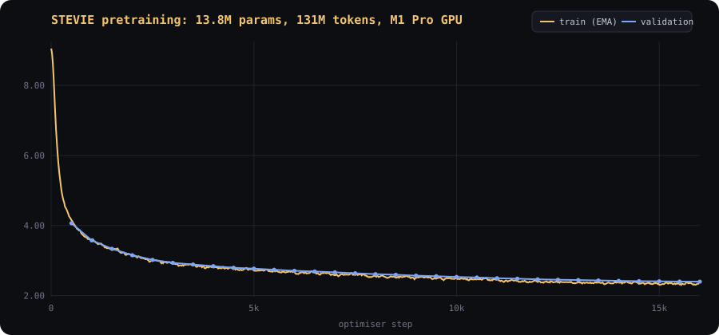

# Training methodology

STEVIE is trained in two stages, both starting points recorded in its model card:

| stage | starts from | data | objective |
|---|---|---|---|
| 1. pretraining | **random initialisation** (seed 1337) | `pretrain-mix`: 137M tokens of general English | next-token prediction on every token |
| 2. supervised fine-tuning | best stage-1 checkpoint | `stevie-sft`: 628 original conversations | next-token prediction on STEVIE's turns only |

No pretrained model, tokenizer or weights from any other project are used at any point.

## The training loop

Implementation: [`crates/glimmer-training/src/trainer.rs`](../crates/glimmer-training/src/trainer.rs).

```text
for step in start..max_steps:
    lr ← schedule(step)                       # pure function of the step: exactly resumable
    batches ← accumulate × sample(rng)        # RNG state is checkpointed
    for each micro-batch:
        loss_mb ← Σ w·nll / supervised_tokens(all micro-batches)
        grads  += ∂loss_mb/∂θ                 # Burn autodiff
    ‖g‖ ← global L2 norm; clip to grad_clip    # one device sync
    skip the step if loss or ‖g‖ is non-finite (logged; abort after 5 in a row)
    θ ← AdamW(θ, g, lr)                        # decoupled weight decay, none on norm gains
    every eval.every: validation loss, best checkpoint, samples, early stopping
    every checkpoint.every: resumable checkpoint (+ pruning)
```

* **Optimiser**: AdamW (β₁ 0.9, β₂ 0.95, ε 1e-8). Lion and SGD+momentum are also available.
  Weight decay applies to weight matrices only; RMSNorm/LayerNorm gains and biases form a
  separate no-decay parameter group.
* **Gradient clipping**: global norm across *all* parameters (Burn's built-in clipping is
  per-tensor, which distorts the update direction), computed on the device in one reduction.
* **Gradient accumulation**: losses are normalised by the total number of supervised tokens across
  all micro-batches, so accumulation is mathematically equivalent to a larger batch. The test
  `gradient_accumulation_matches_large_batch` checks this.
* **Schedules**: linear warmup then cosine, linear, constant, or warmup-stable-decay.
* **Validation**: fixed, evenly spaced windows (pretraining) or every validation conversation
  (SFT), identical across runs so losses are comparable between experiments.
* **Early stopping & best checkpoint**: validation improvements larger than `min_delta` reset the
  patience counter and overwrite `checkpoints/best`; that checkpoint is what gets exported.
* **Mixed precision**: not used. Training runs in f32. Burn can run f16 on Metal, but stable f16
  training needs loss scaling, and correctness takes priority over speed at this scale.

### Checkpoints and resumption

A checkpoint holds model weights, AdamW moments (keyed by persistent parameter ids), the step,
tokens seen, the RNG state, the SFT data cursor, best-validation tracking, the full training config,
the architecture and the tokenizer. Writes are atomic (temporary directory + rename).

`resumed_training_matches_uninterrupted_run` trains 30 steps straight through, then repeats the run
stopping at step 15 and resuming from the checkpoint: the per-step losses after resumption match the
uninterrupted run to 1e-4. Resetting any of optimiser state, schedule position or RNG would fail it.

Burn restores optimiser state on its *default* device (it takes no device argument), and the
default is wgpu whenever GPU support is compiled in. On platforms other than macOS, where GLIMMER
always trains on the CPU, the `glimmer` binary therefore sets `BURN_DEVICE=flex` at start-up
(unless you set it yourself); otherwise resuming would try to open a GPU that may not exist. This
was found by CI on a GPU-less Linux runner.

```bash
glimmer train --resume runs/stevie-pretrain-20261109-231823      # latest checkpoint of a run
glimmer train --resume runs/<run>/checkpoints/step-0008000       # a specific checkpoint
```

### The training monitor

[`monitor.rs`](../crates/glimmer-training/src/monitor.rs) watches the loss, gradient norm and
validation curve, and writes **advice** events: loss spikes, frequent clipping (learning rate
likely too high), very large gradients, rising validation loss with falling training loss
(overfitting), a widening generalisation gap, and plateaus. Advice is never applied
automatically. The only automatic actions are skipping non-finite steps and early stopping, both
configured up front and logged as `auto_action` events, so every run is reproducible from its
config.

## Stage 1: pretraining

Config: [`configs/training/stevie-pretrain.toml`](../configs/training/stevie-pretrain.toml).

| setting | value | why |
|---|---|---|
| model | `tiny`: 6 layers, d_model 384, 6 heads, SwiGLU 1024, context 512, **13.77M parameters** | trains at ~13k tokens/s on the M1 Pro GPU; leaves memory headroom on a 16 GB machine |
| batch | 8 sequences × 512 tokens × 2 accumulation = **8,192 tokens/step** | batch 8 was the most efficient size at context 512 in the throughput sweep |
| steps | 16,000 (**131M tokens** ≈ 0.96 epochs) | one pass over the corpus, no repetition |
| learning rate | peak **1e-3**, 500 warmup steps, cosine to 1e-4 | chosen by the LR range test below |
| regularisation | weight decay 0.1, no dropout, grad clip 1.0 | a single pass over 137M tokens does not overfit |

### Learning-rate range test

Before committing three hours of GPU time, four 300-step probes at constant learning rates (100
warmup steps) were run with the same model and data (`runs/lrprobe-*`):

| peak LR | validation loss @ 300 steps |
|---|---|
| 3e-4 | 4.497 |
| 6e-4 | 4.297 |
| **1e-3** | **4.238** |
| 2e-3 | 4.247 |

Loss improves up to 1e-3 and gets worse by 2e-3, so 1e-3 was chosen as the peak, with cosine decay
providing the low-LR phase that short probes cannot evaluate.

### Pretraining results

Run `stevie-pretrain-20261109-231823`, on an Apple M1 Pro (16 GB) GPU through Metal:

| | |
|---|---|
| steps | 16,000 (completed, no skipped steps) |
| tokens seen | 131,072,000 |
| wall time | 2 h 51 min, including 32 validation passes and sampling |
| throughput | 13.5k tokens/s during training steps (≈ 608 ms per 8,192-token step); 12.7k tokens/s overall |
| final training loss | 2.359 |
| best validation loss | **2.397 (perplexity 11.0)**, at the final step |



| step | tokens | validation loss | perplexity |
|---|---|---|---|
| 500 | 4.1M | 4.064 | 58.2 |
| 1,000 | 8.2M | 3.575 | 35.7 |
| 2,000 | 16.4M | 3.151 | 23.4 |
| 4,000 | 32.8M | 2.839 | 17.1 |
| 8,000 | 65.5M | 2.611 | 13.6 |
| 12,000 | 98.3M | 2.464 | 11.8 |
| 16,000 | 131.1M | 2.397 | 11.0 |

Validation loss was still falling at the last step and tracked training loss closely the whole way,
so the model is under-trained rather than overfitted: more tokens (or a larger model) would help.
For scale, the random-initialisation baseline in [evaluation.md](evaluation.md) is ln(8192) ≈ 9.01.

**What the samples show.** The trainer completes the same three prompts at every evaluation
(temperature 0.7, top-k 40, top-p 0.9, repetition penalty 1.15, fixed seed). Unedited excerpts,
cut at a sentence boundary:

| step | `Once upon a time` | `In Australia,` |
|---|---|---|
| 500 | ", there was a nice girl named Lily. Lily loved to sing all day on her favorite toy box. One day, Lily and Max went to the park to make. They saw many red clothes." | " in the Udlak, and the Calling) was released by a new place for the 2018 Summer Paralymp." |
| 2,000 | ", there was a big bear. The bear had many friends and the animals liked to play with them. One day, they found a little bird in the woods." | " it was held as the Soundland in 1974." |
| 8,000 | ", there was a big bear. The bear lived in the woods with his friends. They liked to play and have fun together. One day, they decided to build a castle." | " it was also one of the most important events in Australia. The event was the first time that the Australian women's national ice hockey team had won the championship at the World Cup." |
| 16,000 | ", there was a boy named Tim. He had a toy bear named Mr. Bear. They loved to play together every day. One day, they found a big, hard rock in their room." | " he was named to the UK's first Australian-based man, and he was given a job as a brig." |

Grammar, story structure and the encyclopaedic register are learned early. Facts are not: at step
16,000 the model still writes "The kangaroo is a small and friendly duck." A 14M-parameter model
trained on 131M tokens learns how English *sounds* far better than what is true, and STEVIE
inherits that limitation.

## Stage 2: conversational fine-tuning

Config: [`configs/training/stevie-sft.toml`](../configs/training/stevie-sft.toml).

* **Data**: packed rows of 512 tokens built from whole conversations; tokens attend only within
  their own conversation, and RoPE positions restart at 0 for each.
* **Loss masking**: only STEVIE's tokens and the `<|end|>` closing each of its turns are targets.
  System prompts, user turns, role tags and padding contribute nothing. STEVIE learns to answer,
  not to imitate users, and learns when to stop.
* **System prompt**: half the examples include "You are Stevie, a friendly Australian AI mate."
* **Short, closely watched training**: the corpus is small (~46k tokens, ~90 packed rows, ~11
  optimiser steps per epoch at batch 8), and a 14M-parameter model memorises it within a few
  epochs: in the first hyperparameter study, validation loss bottomed out after ~2 epochs and then
  climbed from 3.92 to 5.32 while training loss fell to 0.017. The schedule is therefore 54 steps
  (~4.8 epochs, 5 warmup steps, cosine decay), validation runs every 3 steps, early stopping has a
  patience of 6 evaluations, and the best checkpoint is exported. The trainer logs each completed
  epoch so this is visible in the metrics and the TUI.
* **Hyperparameters**: learning rate, weight decay and dropout come from a TPE + successive-halving
  study (see [optimisation.md](optimisation.md)).

### Fine-tuning results

Run `stevie-sft-20261110-022514`, launched from the TUI's Training Lab (that is the run in
[the training screenshots](../assets/screenshots/training.png)). It starts from the best
pretraining checkpoint and uses the winning hyperparameters from the study: peak lr 3.08e-4, 5
warmup steps, cosine decay to 3.08e-5, weight decay 0.106, dropout 0.02, 8 packed 512-token rows
per step.

| step | 3 | 6 | 12 | 18 | 24 | **33** | 39 | 45 | 51 |
|---|---|---|---|---|---|---|---|---|---|
| epochs | 0.25 | 0.5 | 1.0 | 1.5 | 2.1 | **2.9** | 3.4 | 3.9 | 4.4 |
| validation loss | 4.499 | 4.257 | 4.043 | 3.961 | 3.910 | **3.898** | 3.909 | 3.928 | 3.930 |

* Best validation loss **3.898 at step 33** (≈ 2.9 epochs). From step 39 the monitor reported
  overfitting (validation rising while training loss fell). Early stopping ended the run at
  step 51 after 6 evaluations without improvement, and the step-33 checkpoint was exported as
  `models/stevie`.
* 51 steps, 209k tokens, **66 seconds** of wall time. About 46 s of that was one-off Metal kernel
  compilation and autotuning: 27 s for the first training step (packed-attention shapes) and ~19 s
  for the first round of live samples (decoding shapes). The steps themselves ran at ~14k
  tokens/s, 0.29 s each.
* On the held-out *test* conversations, fine-tuning lowered the loss on STEVIE's replies from 4.883
  (pretrained model) to 3.944. General-text test loss rose from 2.367 to 2.571, a modest amount of
  forgetting. See [evaluation.md](evaluation.md).

Fine-tuning has to stop early because the corpus is so small. An ablation that trained the same
configuration for 200 steps (~18 epochs, [`configs/ablations/stevie-sft-overtrained.toml`](../configs/ablations/stevie-sft-overtrained.toml))
drove training loss to 0.21 and validation loss up to 4.79, and its replies started quoting the
training conversations verbatim (details in [evaluation.md](evaluation.md)).

## Reproducing STEVIE

```bash
glimmer data pipeline                      # ≈ 5 min: download, clean, tokenizer, datasets
glimmer tune stevie-sft-search             # optional: re-run the SFT hyperparameter study
glimmer train --model stevie               # pretraining (~3 h on an M1 Pro) then SFT
glimmer evaluate --baseline --model runs/<pretrain-run>/checkpoints/best --model stevie
```

Seeds are fixed for weight initialisation, data sampling, splits and dropout. Bitwise-identical
reruns are guaranteed on the CPU backend; on Metal, autotuning can choose different kernels between
processes, so reruns agree to floating-point rounding rather than bit for bit.
